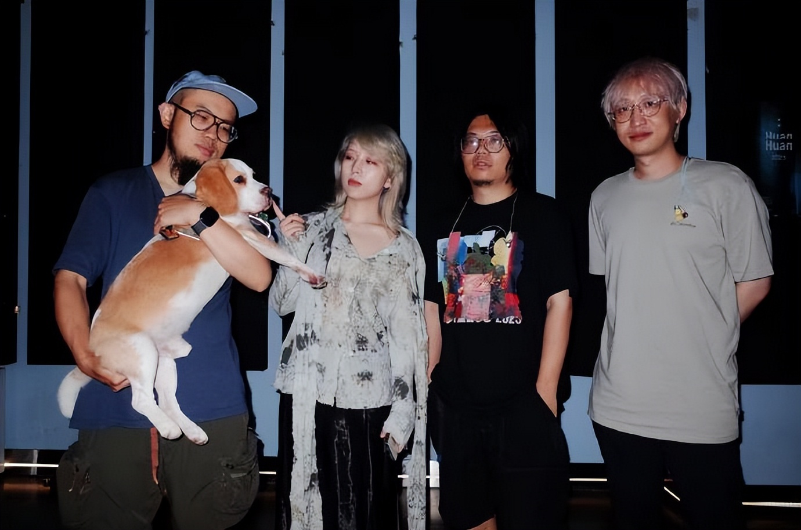

世界杯又来了。社交平台开始被赛程表、进球集锦和伪球迷的赌球截图填满。每到这种时候，我的脑海里总有一支队伍准时造访——不是中国队，他们连门都没摸到。是那支乐队。那支叫 Chinese Football 的乐队。

## 游戏开始

徐波给乐队起这个名字，本来是一次精准的冒犯——他把美国 Emo 乐队 American Football 前面的"American"换成了"Chinese"，再顺手借来中国足球队那句著名的口号：冲出亚洲，走向世界。一个二十多岁的建筑设计师在武汉的排练房里，对着自己的乐器，宣布了一件他其实并不太在意的事。

徐波后来说，他对足球谈不上热爱，大部分足球启蒙来自《足球小将》。那些遍布首张专辑的体育意象——守门员、不是人人都能穿十号球衣、红牌罚下以及帽子戏法——与其说是球迷的叙事，不如说是一个旁观者从体育报道、校园操场和集体记忆里捡来的符号。他用这些符号搭建了一座关于青春的失败博物馆：奔跑过的四百米操场、穿不上十号球衣的自己、被罚下场的冲动、以及一场没有赢过的比赛。

2015年9月，同名专辑 *Chinese Football* 发布。封面似乎借鉴了少林足球，而开场曲叫"游戏开始"。整张专辑被设计成一场完整的足球赛，从开场到终场哨响。我记得第一次完整听完它的那个夜晚，400米的吉他分解和弦一响，我望着无尽的夜空，忽然觉得十几岁所有说不出口的沮丧都被一个人用乐器讲清楚了。

四百米操场是所有人的青春遗址。它不分城市和县城，不分重点中学和职高，塑胶跑道还是煤渣跑道都无所谓，形状永远一样，圈数永远算不清楚。体育老师吹哨的时候，总有人偷偷系鞋带，总有人从一开始就落在最后。你跑得肺里全是铁锈味，跑到觉得人生就要在这一圈结束，然后你听见看台上有人喊你的名字，或者没有人喊。Chinese Football 把这段跑道变成了一段吉他分解和弦，四百米的长度刚好够一个少年在脑海里过完他所有的心事。那些心事后来被证明并不重要，但当时的重量是真实的，和跑完一千米之后肺里的灼烧感一样真实。

## 世界上最后一个 Emo 男孩

那几年"Emo"在中国独立音乐场景里仍是个有些尴尬的标签。它不像后摇那样自带高级感，也不像朋克那样有反叛的光环。Emo 意味着脆弱，意味着一个男生站在麦克风前面唱自己的伤心事，这在当时的中文世界里几乎是社交自杀。徐波知道这一点，所以他给自己加了一层戏谑的保护壳——乐队名是玩笑，专辑封面是像素游戏，好像在说Don't be so serious，你只要听过，就知道他有多当真。Chinese Football 的吉他部分揉合了数学摇滚的精密与 Emo 的直接，清音分解和弦和失真轰鸣之间几乎没有过渡，就像情绪本来的样子——你以为自己好好的，然后一秒之内什么都碎了。

乐迷们开始叫他们"国足"。徐波对外的官方回答是："不管乐队的名字是什么意义，只要它引起了你的注意让你去问这个问题，我们的目的就达到了。"但他后来承认，这只是"装x"，真实原因就是对 American Football 的喜欢。"世界上最后一个 Emo 男孩 / 女孩"——这是乐迷给 Chinese Football 贴的标签，后来被乐队自己接了过来，变成一种温柔的宣言：保护世界上最后一个柔软又脆弱的 Emo 男孩。

## 漂流人间

2017年，鼓手郑紫莉加入，EP *Here Comes a New Challenger!* 发行。2019年，另一张 EP *Continue?* 问世。在这两张专辑里面，他们正式的定义了他们的风格：敲打着心房的鼓点，清脆的telecaster带来的独特音色，以及徐波那数十年如一日的清澈声音。

"漂流人间"的现场有一种奇特的仪式感。前奏的吉他分解出来的时候，台下几百个人会同时安静下来，时间流逝，大家开始高喊"在人间漂流！"。和摇滚乐现场的刻板印象不同，这些现场更像一群人在某个深夜的天台上，对着城市的灯光，把各自藏了很久的无力感借这首歌放出来。

而冒险岛更像是另一个星球的产物。"一样/不一样/一样/不一样"的反复透露出一种对不合群的害怕，而地平线之外会不会有人存在——这个问句本身就暴露了问题的全部：你害怕的不是孤独，你害怕的是孤独竟然可以被复制。你穿越了那么多地方寻找"另一个我"，其实只是想确认，"现在的我"可以被另一个人接受。而那个人，也许一直都在。

大约也是在这个时间，徐波辞去了建筑设计师的工作，去日本游学。他当时三十岁左右。三十岁辞掉一份体面的工作去学音乐，这在任何时代都不是一个"聪明"的决定。建筑设计师的收入、社会地位、职业前景，每一样都指向一条清晰的上坡路。但音乐指向的是排练房里的泡面、巡演路上睡过的沙发、以及家人欲言又止的眼神。但我们总是明白"应该做什么"，明白到几乎忘了"想做什么"是什么感觉。那条看起来更远的路，徐波真的走通了。他带着建筑学训练出的结构感去写歌，把图纸上的秩序翻译成音符里的秩序，这本身就是一种关于人生可能性的论证。

## Win & Lose

2022年底，第二张全长专辑 *Win&Lose* 发行。和上一张相隔七年。七年里发生了很多事：疫情、巡演停滞、音乐产业的剧变、每个普通人的生活都被打乱。这些变化凝结成了国足的词句和符号：四月的渺小水滴，世界一分为二时的笑或泪、进或退，再到武汉里把对这片沃土的情感化作声声呐喊，等到我们可以坦然说Goodbye的时候，Win Or Lose都不太重要。而"游戏三部曲"——从 *Here Comes a New Challenger!* 到 *Continue?* 再到 *Win&Lose*——也在这一刻画上了句号。

游戏是这代人的母语。我们学会的第一个英文单词可能是"PLAY"，也可能是"START"。我们比任何一代人都更熟悉游戏的语法：三条命、存档点、续关画面上的倒计时。人生被翻译成一场横版过关游戏的时候，失败就变得可以忍受了——被打败只是扣一条命，GAME OVER 之后还可以 CONTINUE。但 Chinese Football 用三张专辑讲完了这个隐喻的完整弧线：从兴致勃勃按下开始，到迎来那个闯入者，再到不甘心地续币，直到终于接受这局的结果。他们告诉你，CONTINUE 不是无限的。有些局输了就是输了，没有重来的机会。但知道这一点之后，你反而更愿意认真打完最后那一场。这是他们的人生，他们把这些感悟写成歌，带到舞台上，直到它们变成我们的故事。

## 冲出亚洲

2023年，Chinese Football 做了一件让所有乐迷都没想到的事——他们真的冲出亚洲了。日本、英国、欧洲巡演，多场售罄。那个写着"冲出亚洲，走向世界"的乐队，在成立十二年后，以一种谁都没预料到的方式兑现了这句玩笑般的承诺。乐迷在评论区刷屏："国足冲出亚洲了""国足牛逼"。那一刻的荒诞和动人几乎等量。

2025年初，他们登上了芝加哥的 Audiotree——一个在 YouTube 上拥有近九十万订阅的知名现场音乐平台。这是 Audiotree 首次迎来中国大陆乐队。五首现场曲目，台下是芝加哥的观众，台上是四个从武汉走出来的中国人。徐波站在那里，弹着吉他，用中文和英文交替唱歌。没有人提到足球，但每个人都听懂了那个关于出发和归来的故事。同一年他们还去过了KEXP和WNYU，在摇滚的神殿留下了我们这群emokids的声音。冲出亚洲，走向世界，全力以赴，体无完肤，他们做到了，带着无数人的笑与泪一起。

## 世界杯又不关我们的事

2026年的世界杯，中国足球依然没有出现。这已经不值得惊讶了，甚至不值得愤怒。它更像是一种熟悉的背景噪音，每隔四年响一次，提醒你某些东西从未改变。

但有些东西变了。在武汉的某个排练房里，一个曾经的建筑设计师和他的三个朋友，用吉他、贝斯和鼓，把"中国足球"这四个字从一场持久的集体尴尬里救了出来，赋予了它一种全新的、私人的、属于每个曾在深夜被一段旋律击中的人的含义。

他们不是在踢足球。他们是在用"足球"这个词，讲我们所有人的故事——关于那些全力以赴却体无完肤的时刻，关于明知没有结果还是想再跑一次的冲动，关于一场注定要输的比赛里，依然值得被记住的每一次传球。

很多年后，如果有人问起这个时代的中国独立音乐留下了什么，也许有人会提到 Chinese Football。不是因为他们的技术多好，或者名气多大，而是因为他们给一种无法命名的心情找到了名字。"中国足球"这四个字，曾经是体育版上最让人沉默的标题，是饭桌上没有人愿意接的话题，是每当世界杯来临就被重新翻出来的旧伤疤。但现在，你输入这四个字，搜索框的联想里会出现一支乐队。他们唱的不是足球，是你在四百米跑道上流过汗又擦掉，是你在深夜对着天花板想通又想不通的那些事。他们没有赢过任何一场比赛，但他们让"输"这件事，有了一种可以被循环播放的尊严。

世界杯的热闹是别人的。但"中国足球"这四个字，终于有了一种让我愿意反复提起的重量。

## 参考资料

1. Chinese Football 乐队百科 — [https://m.baike.com/wiki/Chinese%20Football/7208349758304523555](https://m.baike.com/wiki/Chinese%20Football/7208349758304523555)
2. Chinese Football：冲出亚洲，走向世界 — 豆瓣 — [https://www.douban.com/note/851427082/](https://www.douban.com/note/851427082/)
3. Chinese Football (Audiotree Live) - EP — Shazam — [https://www.shazam.com/zh-cn/album/1788933663/chinese-football-audiotree-live-ep](https://www.shazam.com/zh-cn/album/1788933663/chinese-football-audiotree-live-ep)
4. Chinese Football 徐波：漂流人间 — 网易新闻 — [https://c.m.163.com/news/a/F2UI80HQ0541040Y.html](https://c.m.163.com/news/a/F2UI80HQ0541040Y.html)
